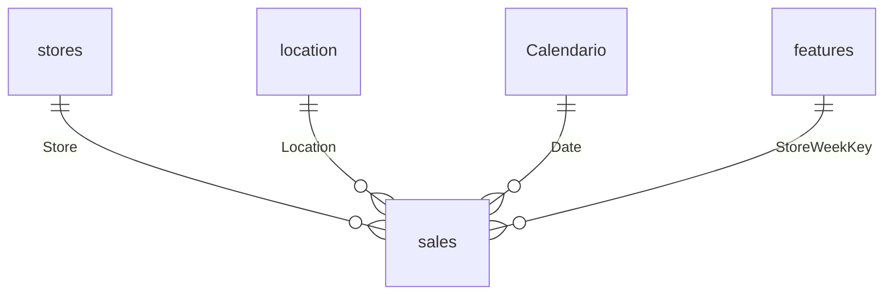

# Informe Final de Gestion Analitica de Datos con PowerBI

**Caso:** Gestión Analítica de Datos  
**Período analizado:** 2011–2012  
**Herramientas:** Microsoft Power BI Desktop

## Resumen ejecutivo

Se integraron y prepararon los datos de ventas semanales, tiendas y condiciones semanales. El modelo resultante relaciona las ventas con calendario, ubicación, tienda y contexto semanal de características mediante una clave `Store + Date`. La revisión de filas y relaciones confirmó 280.891 ventas, 4.680 registros de características, 45 tiendas, 12 ubicaciones y cero filas de ventas sin correspondencia en características.

El total de ventas de 2011–2012 es 4.448.332.866,70. Para 2012 con temperaturas mayores a 20 en la escala original de la fuente, el total es 1.994.956.776,32 y la venta máxima semanal es 233.140,32. El período de ventas de 2012 termina el 26 de octubre, por lo que no se interpreta como un año completo.

## Objetivo y alcance

Construir un modelo de Power BI que permita analizar ventas por período, tienda, tipo de tienda, ubicación y tipo de día. La segunda página analítica se enfoca en 2012 y en semanas cuyo valor de temperatura supera 20, siguiendo el umbral pedido en el material del curso. No se atribuye una unidad a temperatura porque no fue confirmada en la fuente disponible.

## Fuentes y granularidad

- `sales.csv`: 280.891 filas. Una fila representa las ventas semanales de una tienda y departamento; contiene fecha, ventas semanales, feriado, tienda, departamento y ubicación.
- `features.csv`: 4.680 filas. Una fila representa el contexto semanal de una tienda, con temperatura, combustible, IPC, desempleo, feriado y descuentos.
- `stores.csv`: 45 filas, una por tienda, con tipo y tamaño.
- `location`: dimensión creada en Power Query a partir de valores distintos de la columna Location de ventas; contiene 12 ubicaciones.
- `Calendario`: tabla DAX diaria desde 07/01/2011 hasta 28/12/2012, generada con la fecha mínima de ventas y la fecha máxima de características.

La fecha de ventas más reciente es 26/10/2012, mientras que `features` continúa hasta 28/12/2012. Por eso algunas semanas tardías existen en características, pero no tienen ventas. Esos vacíos se conservaron como vacíos y el selector semanal del informe se limitó al período de ventas.

## Limpieza y preparación

### Encabezados y tipos de datos

Se promovió la primera fila como encabezados. Se descartaron los cambios automáticos de tipo que interpretaban de forma incorrecta algunos valores y se asignaron tipos de manera explícita:

- Fechas convertidas con configuración regional Español (Argentina), respetando el orden día/mes/año de los archivos.
- `Store` y `Dept` como enteros; ventas semanales como decimal.
- Temperatura, combustible, IPC, desempleo y descuentos como números decimales; valores con punto decimal interpretados con configuración regional Inglés (Estados Unidos).
- `IsHoliday` como booleano y ubicación/tipo como texto.
- `stores[Size]` como decimal usando Inglés (Estados Unidos). El valor de la tienda 1 se mantuvo en 1513,15; no se reescaló porque la unidad no se validó.

### Valores ausentes y descuentos

En `MarkDown1` a `MarkDown5`, el texto `NA` se reemplazó por `null` para representar valores ausentes como nulos. No se sustituyeron por cero, porque cero implicaría que se observó una ausencia de descuento con valor medido igual a cero. Los campos originales permanecen disponibles.

### Columnas ajustadas y cautelas

Se conservaron `Fuel_Price` y `Unemployment` originales y se agregaron columnas derivadas para análisis:

- `Fuel_Price_Ajustado`: si `Fuel_Price > 10`, dividir por 1000; en otro caso conservar el valor. Por ejemplo, 2976 pasa a 2,976 y 3,01 se conserva.
- `Unemployment_Ajustado`: si `Unemployment > 20`, dividir por 1000; en otro caso conservar el valor. Por ejemplo, 7742 pasa a 7,742.

Estas reglas responden a una inconsistencia aparente de escala en los datos originales. Son ajustes propuestos y auditables, no correcciones confirmadas por Henry. Los indicadores de ventas de este informe usan `Weekly_Sales`; los campos ajustados no alteran esos totales.

### Clave de contexto semanal

Se creó `StoreWeekKey` en `features` y `sales`, concatenando tienda con fecha normalizada como `Store|yyyyMMdd`. La clave es única en `features`, donde existe un registro de contexto por tienda y semana, y se repite en ventas por los distintos departamentos.

## Modelo y relaciones

El modelo usa `sales` como tabla de hechos. Las tablas de referencia filtran ventas en una dirección, desde el lado uno hacia el lado muchos. `features` no se conectó directamente con `stores` ni con `Calendario`, evitando rutas de filtro ambiguas; su contexto semanal llega a ventas por `StoreWeekKey`.

| Lado uno     | Clave          | Lado muchos | Clave          |
| ------------ | -------------- | ----------- | -------------- |
| `stores`     | `Store`        | `sales`     | `Store`        |
| `location`   | `Location`     | `sales`     | `Location`     |
| `Calendario` | `Date`         | `sales`     | `Date`         |
| `features`   | `StoreWeekKey` | `sales`     | `StoreWeekKey` |

Todas las relaciones están activas y tienen cardinalidad 1 a muchos. La comprobación de la relación semanal dio cero filas de ventas sin correspondencia en características.

## Medidas principales

- **Total ventas:** suma de `sales[Weekly_Sales]`.
- **Venta máxima / Venta mínima:** máximo y mínimo de `sales[Weekly_Sales]` en el contexto de filtros.
- **Ventas festivo / Ventas no festivo:** totales condicionados por `IsHoliday`.
- **Semanas festivas / no festivas:** recuento distinto de `StoreWeekKey` por tipo de día.
- **Promedios por tienda-semana:** ventas correspondientes divididas por el número de claves tienda-semana de cada tipo de día.
- **Tipo de día:** etiqueta derivada `Festivo` o `No festivo` a partir de `IsHoliday`.
- **Año:** columna de calendario creada con `YEAR(Calendario[Date])`.

Las medidas DAX completas están en `Medidas_DAX.md`.

## Resultados e insights

### Vista general de 2011–2012

| Indicador                      |        Resultado |
| ------------------------------ | ---------------: |
| Ventas totales                 | 4.448.332.866,70 |
| Venta máxima por fila semanal  |       649.770,18 |
| Venta mínima por fila semanal  |        -3.924,00 |
| Ventas 2011                    | 2.448.200.007,35 |
| Ventas 2012 (hasta 26/10/2012) | 2.000.132.859,35 |

La venta mínima negativa está en la fuente y se conservó; no se asumió que fuera un error sin una regla de negocio que lo justifique.

### Ventas por tipo de tienda y ubicación

| Tipo de tienda |           Ventas |
| -------------- | ---------------: |
| A              | 2.865.584.304,61 |
| B              | 1.310.723.000,91 |
| C              |   272.025.561,18 |

Las tiendas tipo A concentran el mayor volumen, seguidas por B y C. Por ubicación, US-NY presenta el mayor total (887.532.917,32) y US-MD el menor (69.480.974,20) en el período completo. Estos resultados comparan importes acumulados; no se normalizaron por cantidad de tiendas ni por tamaño.

### Comparación de días festivos

En el período completo, el anillo muestra aproximadamente 6,86 % de ventas en semanas marcadas como festivas y 93,14 % en semanas no festivas. Las tarjetas de promedio del informe presentan aproximadamente 1,13 millones por tienda-semana festiva y 1,03 millones por tienda-semana no festiva. La diferencia es descriptiva y no prueba que los feriados causen el cambio.

### 2012 con Temperature > 20

| Indicador                                     |        Resultado |
| --------------------------------------------- | ---------------: |
| Ventas 2012 sin filtro de temperatura         | 2.000.132.859,35 |
| Ventas 2012 con Temperature > 20              | 1.994.956.776,32 |
| Venta máxima con Temperature > 20             |       233.140,32 |
| Proporción festiva dentro de ventas filtradas |           4,90 % |

El contexto de temperatura filtra ventas a través de la relación por tienda y semana. Se validó que el total filtrado cambia al elegir tienda y que la selección de año, semana, ubicación, tipo de tienda y tipo de día interactúa con el informe.

## Páginas del informe

1. **Portada:** título, alcance, botones de navegación a las páginas analíticas.
2. **Reporte General:** KPIs, serie temporal, ventas por tipo de tienda, ventas por ubicación, participación festiva y promedios por tienda-semana; segmentadores de año, tienda y ubicación.
3. **Ventas 2012 - Temperatura > 20:** serie semanal, anillo Festivo/No festivo y KPIs; filtros de año, semana, tienda, tipo de tienda, ubicación y tipo de día, con `Temperature > 20` aplicado.

## Controles de calidad realizados

| Tabla/control                                                 |     Resultado esperado |           Resultado validado |
| ------------------------------------------------------------- | ---------------------: | ---------------------------: |
| `sales`                                                       |          280.891 filas |                      280.891 |
| `features`                                                    |            4.680 filas |                        4.680 |
| `stores`                                                      |               45 filas |                           45 |
| `location`                                                    |               12 filas |                           12 |
| Claves de `features[StoreWeekKey]`                            |                 Únicas | Únicas; relación 1:\* activa |
| Ventas sin clave correspondiente en `features`                |                      0 |                            0 |
| Filtros de fecha, tienda, ubicación y contexto de temperatura | Cambian los resultados |         Probados en Power BI |

## Conclusiones y limitaciones

El modelo permite explorar las ventas y usar las características semanales de tienda para segmentar las métricas. Los resultados principales son coherentes con los valores del informe de referencia, con una diferencia explícita entre el total de 2012 sin filtro de temperatura y el total con `Temperature > 20`.

La comparación anual no cubre doce meses completos para 2012: las ventas disponibles terminan el 26 de octubre. La temperatura se analizó con el umbral numérico solicitado sin asignar unidad. Los ajustes de combustible y desempleo son hipótesis de normalización y se conservaron junto a los campos originales. El tamaño `1513,15` se mantuvo en su escala de origen hasta contar con documentación de unidad.

## Archivos de entrega

- `powerbi/PI_GAD_PowerBI.pbix`: archivo principal de Power BI con tres páginas: Portada, Reporte General y Ventas 2012 - Temperatura > 20.
- `datos/Datawarehouse.xlsx`: libro original de referencia del proyecto.
- `datos/raw/`: CSV originales de ventas, características semanales y tiendas.
- `docs/Informe_Final.md`: informe detallado de limpieza, modelo, medidas, hallazgos, validaciones y limitaciones.
- `docs/Medidas_DAX.md`: fórmulas DAX implementadas.
